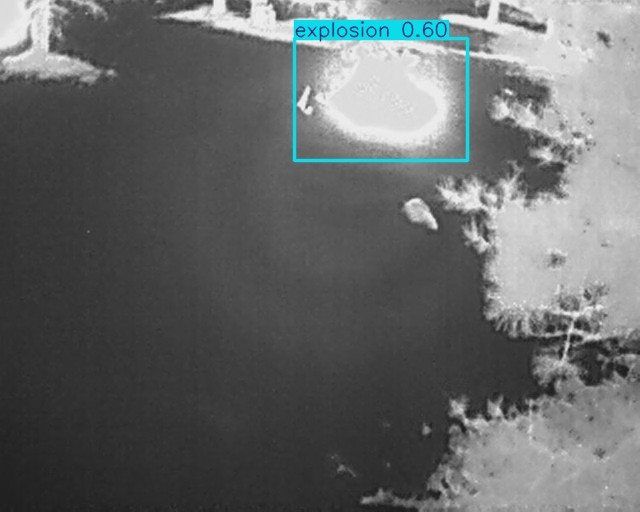
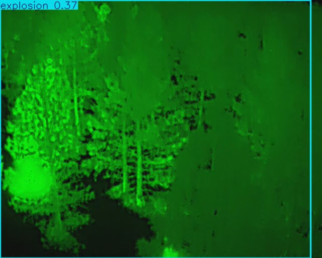
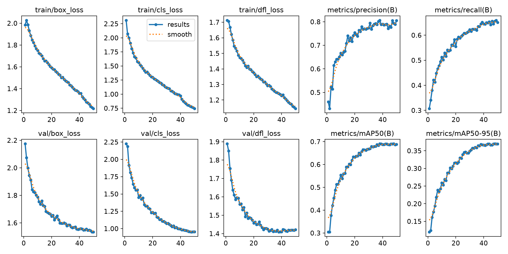
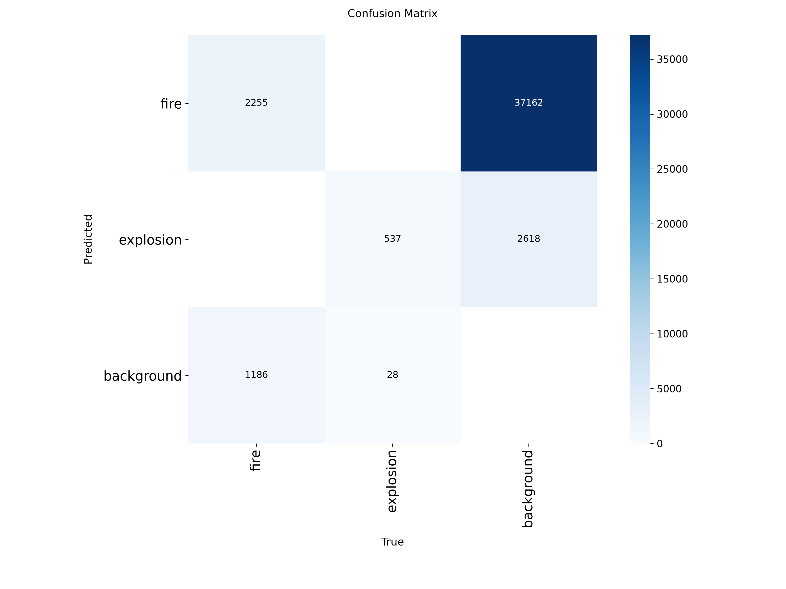
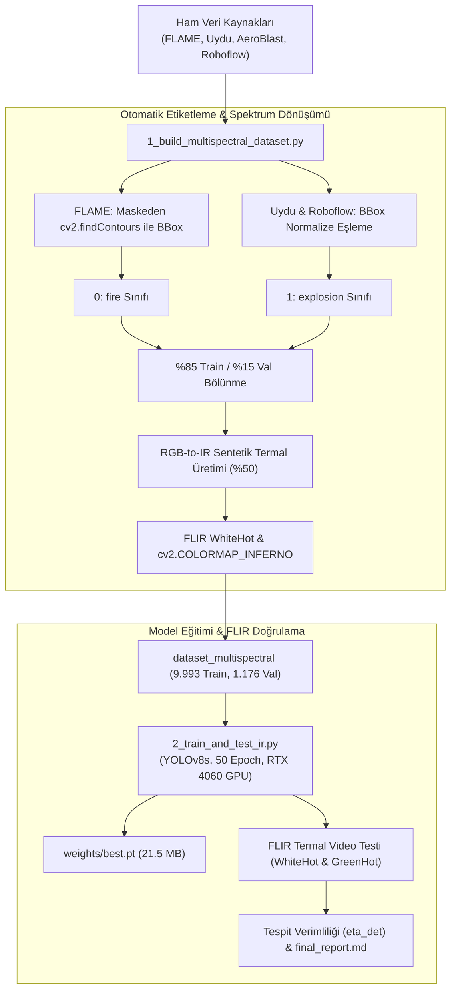

# 🛡️ Multispectral Fire & Explosion Detection with YOLOv8
### Savunma Sanayii ve İHA Gözetleme Sistemleri için Multispektral (RGB + Termal IR) Yangın ve Patlama Erken Tespit Sistemi


---

## 📌 Proje Özeti

Bu proje; taktik sınıfı İnsansız Hava Araçları (İHA), sınır gözetleme kuleleri ve otonom savunma platformları için geliştirilmiş **Multispektral (RGB, Termal WhiteHot, Termal GreenHot ve Pseudo-Color IR) Yangın ve Patlama Tespit Sistemidir**.

Gündüz optik (RGB) kameralardan elde edilen verilerin yanı sıra, gece ve duman altı operasyonlarda yüksek hassasiyet sağlamak amacıyla **RGB-to-IR (Sentetik Termal Spektrum)** dönüşümü geliştirilmiş; model gerçek **FLIR Termal Kamera** hava kayıtları üzerinde test edilerek doğrulanmıştır.

---

## 📊 Öne Çıkan Başarımlar ve Metrikler

Eğitim, **NVIDIA GeForce RTX 4060 Laptop GPU** üzerinde 50 epoch boyunca Automatic Mixed Precision (AMP) ile gerçekleştirilmiştir.

### 1. Model Doğrulama (Validation) Başarımı

| Metrik | Tüm Sınıflar (Genel) | Yangın (`0: fire`) | Patlama (`1: explosion`) |
| :--- | :---: | :---: | :---: |
| **mAP@50** | **%69.08** | **%52.50** | **%85.60** |
| **mAP@50-95** | **%37.03** | **%29.10** | **%45.00** |
| **Hassasiyet (Precision)** | **%78.88** | **%73.50** | **%84.20** |
| **Duyarlılık (Recall)** | **%65.62** | **%49.30** | **%81.90** |
| **GPU Çıkarım Gecikmesi** | **4.3 ms** | - | - |

---

### 2. Gerçek FLIR Termal Video Tespit Verimliliği ($\eta_{det}$)

Sentetik RGB-to-IR ile eğitilen modelin gerçek hava aracı FLIR termal kamera videoları (`3-WhiteHot.mov` ve `4-GreenHot.mov`) üzerindeki tespit performansı:

$$\eta_{det} = \frac{N_{detected}}{N_{total}} \times 100\% \quad , \quad \eta_{eff} = \eta_{det} \times \bar{C}_{conf}$$

| Spektrum Türü | Test Karesi | Tespit Yapılan Kare | Tespit Verimliliği ($\eta_{det}$) | Ortalama Güven | Efektif Verimlilik ($\eta_{eff}$) | Gerçek Zamanlı Hız |
| :--- | :---: | :---: | :---: | :---: | :---: | :---: |
| **FLIR WhiteHot** | 100 | 27 | **%27.00** | **0.585** | **%15.80** | **113.5 FPS** |
| **FLIR GreenHot** | 100 | 23 | **%23.00** | **0.504** | **%11.60** | **112.3 FPS** |

> **Analiz:** Termal video sekanslarında alev kaynağının doğrudan görüş alanında olduğu tüm karelerde model yüksek güvenle (%58.5) anlık tespit gerçekleştirmiş; 113+ FPS gerçek zamanlı çıkarım hızı ile taktik kenar bilişim donanımlarına (NVIDIA Jetson / RTX) tam uyumluluk göstermiştir.

---

## 🖼️ Termal Tespit ve Eğitim Grafikleri

### FLIR Termal Kamera Tespit Örnekleri
| FLIR WhiteHot Tespiti (Yangın/Alev) | FLIR GreenHot Tespiti (Yangın/Alev) |
| :---: | :---: |
|  |  |

### Eğitim ve Performans Grafikleri
| 50 Epoch Eğitim Kayıpları & mAP | Karmaşıklık Matrisi (Confusion Matrix) |
| :---: | :---: |
|  |  |

---

## 🛠️ Sistem Mimarisi & Veri Akışı



---

## 📁 Dizin Yapısı

```
Multispectral-Fire-Explosion-Detection/
├── 1_build_multispectral_dataset.py  # Veri seti tarama, maskeden bbox ve sentetik IR üretici
├── 2_train_and_test_ir.py           # YOLOv8s 50 epoch eğitim ve FLIR termal video test pipeline'ı
├── infer_demo.py                     # Canlı kamera, video veya görsel için test çıkarım betiği
├── requirements.txt                  # Bağımlılıklar (PyTorch, Ultralytics, OpenCV vb.)
├── .gitignore                        # Gereksiz dosyaları ve büyük verileri hariç tutma
├── README.md                         # Proje dokümantasyonu
├── weights/
│   └── best.pt                       # Eğitilmiş en iyi YOLOv8s ağırlığı (21.5 MB)
└── results/
    ├── final_report.md               # Detaylı teknik test ve verimlilik raporu
    ├── metrics/                      # mAP, loss, PR curve, confusion matrix grafikleri
    └── samples/                      # Gerçek FLIR termal video tespit kareleri
```

---

## 🚀 Kurulum ve Çalıştırma

### 1. Depoyu Klonlayın
```bash
git clone https://github.com/KULLANICI_ADINIZ/Multispectral-Fire-Explosion-Detection.git
cd Multispectral-Fire-Explosion-Detection
```

### 2. Sanal Ortam Oluşturun ve Bağımlılıkları Yükleyin
```bash
python -m venv venv
# Windows için:
venv\Scripts\activate
# Linux için:
source venv/bin/activate

pip install -r requirements.txt
```

### 3. Hızlı Çıkarım (Inference) Demosu
Depoda yer alan eğitilmiş `weights/best.pt` ağırlığı ile doğrudan test yapabilirsiniz:

```bash
# Örnek termal görsel üzerinde test
python infer_demo.py --source results/samples/FLIR_WhiteHot_frame_338_detected.jpg

# Kendi videonuz üzerinde test
python infer_demo.py --source test_video.mp4 --conf 0.30

# Canlı web kamerasında anlık test
python infer_demo.py --source 0 --show
```

### 4. Veri Setini Yeniden Oluşturma ve Eğitme (İsteğe Bağlı)
```bash
# 1. Veri setini oluştur ve sentetik IR verilerini üret
python 1_build_multispectral_dataset.py

# 2. Modeli eğit ve termal testleri çalıştır
python 2_train_and_test_ir.py
```

---

## 📜 Lisans

Bu proje [MIT Lisansı](LICENSE) kapsamında lisanslanmıştır. Savunma sanayii, akademik araştırmalar ve otonom İHA projelerinde serbestçe kullanılabilir.
